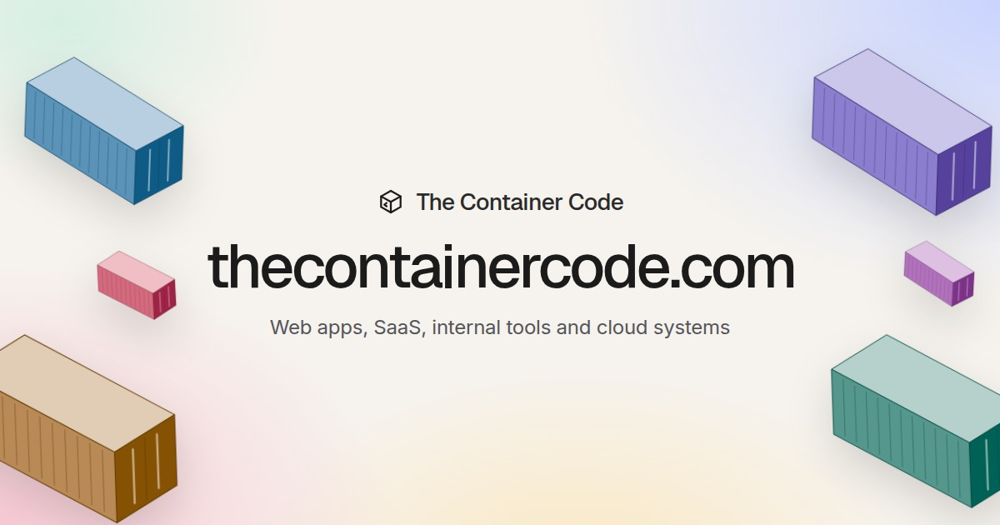

  

### An independent software studio

We design, build and run web applications, SaaS platforms, internal tools and the cloud systems behind them. We are a small, senior, fully remote team based in India, and the engineers you talk to are the engineers who build your software.

**What we build**

| | |
| :-- | :-- |
| **Web applications** | Built around how your business actually works |
| **SaaS platforms** | Sign-up, billing and account management that hold up as you grow |
| **Internal tools** | Admin panels and operations consoles that fit the way your team works |
| **APIs and integrations** | Documented APIs that connect your systems, payments and third-party services |
| **Cloud and edge** | Infrastructure that keeps responses fast, maintenance low and costs predictable |
| **Automation and AI** | Practical automation that takes repetitive work off your team |

**How we work.** Discover, plan, build in weekly cycles with working demos, then launch and keep improving. Every step ends with something you can read, run or click.

  <a href="https://thecontainercode.com">thecontainercode.com</a> ·
  <a href="mailto:hello@thecontainercode.com">hello@thecontainercode.com</a> ·
  <a href="https://x.com/thecontainercod">X</a> ·
  <a href="https://www.linkedin.com/company/thecontainercode/">LinkedIn</a>

